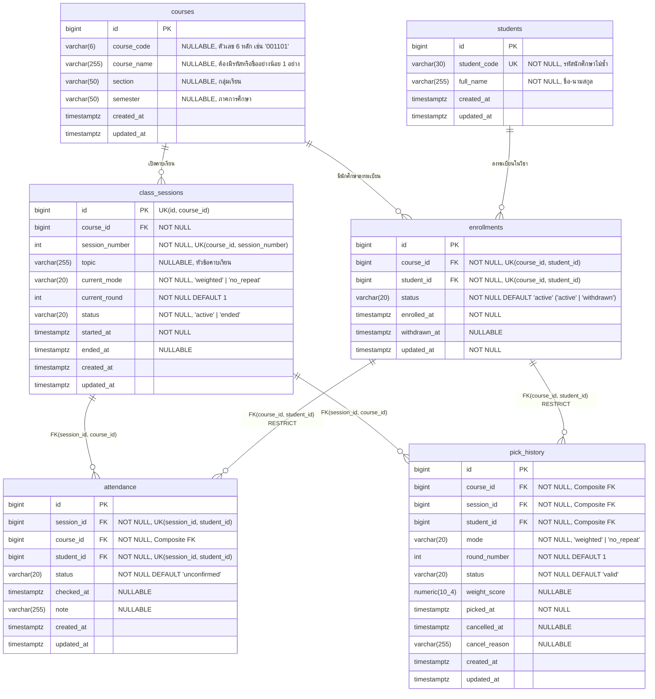

# เอกสารออกแบบฐานข้อมูลและอัลกอริทึมการสุ่ม (Database Design & Randomization Specification)

เอกสารนี้อธิบายโครงสร้างฐานข้อมูล **PostgreSQL 18** โมเดล **GORM (Go)** การจัดการ Constraints เพิ่มเติมด้วย SQL Migration และตรรกะระบบสุ่มรายชื่อสำหรับโปรเจกต์ **FairPick**

---

## 1. ภาพรวมการออกแบบ (Overview)

ฐานข้อมูลชื่อ `fairpick` ประกอบด้วย **6 ตารางหลัก** ที่ออกแบบโดยยึดหลักความถูกต้องของข้อมูล (Data Integrity) ในระดับฐานข้อมูล ควบคู่กับความเรียบง่ายสำหรับพัฒนาใน Mini Project:

1. **`courses`** — ข้อมูลรายวิชา (รหัสวิชา 6 หลัก, ชื่อวิชา, กลุ่มเรียน, ภาคการศึกษา)
2. **`students`** — ข้อมูลนักศึกษากลางของระบบ (รหัสนักศึกษา, ชื่อ-นามสกุล)
3. **`enrollments`** — ตารางเชื่อมความสัมพันธ์ระหว่างรายวิชากับนักศึกษา พร้อมสถานะการลงทะเบียน (`active` / `withdrawn`) เพื่อคงประวัติย้อนหลัง
4. **`class_sessions`** — ข้อมูลคาบเรียนแต่ละครั้งของรายวิชา
5. **`attendance`** — ข้อมูลเช็กชื่อเข้าเรียนของนักศึกษาในแต่ละคาบ
6. **`pick_history`** — ประวัติการสุ่มรายชื่อนักศึกษาในแต่ละคาบ (ทั้งโหมด `weighted` และ `no_repeat`)

---

## 2. แผนภาพความสัมพันธ์ของข้อมูล (ER Diagram)



### คำอธิบายความสัมพันธ์และการคงประวัติย้อนหลัง (Relationships & History Preservation)

1. **`courses` (1) ↔ (M) `enrollments` (M) ↔ (1) `students`**
   - ความสัมพันธ์แบบ Many-to-Many ระหว่างรายวิชากับนักศึกษาผ่านตาราง `enrollments`
   - มี `UNIQUE (course_id, student_id)` ป้องกันการลงทะเบียนซ้ำในรายวิชาเดียวกัน
   - ตาราง `enrollments` มีคอลัมน์ `status` (`'active'` | `'withdrawn'`) เพื่อรองรับการถอนนักศึกษาออกจากรายวิชาโดยที่ประวัติการเข้าเรียน (`attendance`) และประวัติการถูกสุ่ม (`pick_history`) ในอดีตไม่สูญหาย
2. **`courses` (1) ↔ (M) `class_sessions`**
   - รายวิชา 1 วิชาเปิดคาบเรียนได้หลายคาบ แต่มีคาบที่ `status = 'active'` ได้เพียงครั้งละ 1 คาบต่อรายวิชาเท่านั้น
3. **`class_sessions` & `enrollments` (1) ↔ (M) `attendance` และ `pick_history`**
   - ตาราง `attendance` และ `pick_history` มี Composite Foreign Key อ้างอิงไปยัง:
     1. `class_sessions (id, course_id)` — ยืนยันว่า `session_id` เป็นของ `course_id` นั้นจริง
     2. `enrollments (course_id, student_id)` แบบ **`ON DELETE RESTRICT`** — ยืนยันว่านักศึกษาลงทะเบียนในรายวิชานั้นจริง และป้องกันไม่ให้ลบข้อมูลใน `enrollments` หรือ `students` ทิ้งหากมีประวัติการเข้าเรียนหรือประวัติการสุ่มบันทึกอยู่แล้ว

---

## 3. กฎการจัดการค่า `NULL` และข้อความว่าง (NULL & Empty String Normalization)

เพื่อให้การตรวจสอบเงื่อนไขและ Unique Constraints ใน PostgreSQL ทำงานสอดคล้องกัน 100% จึงกำหนดกฎมาตรฐานดังนี้:

1. **ฝั่ง Backend (Go Normalization ก่อนบันทึก):**
   - ทุกฟิลด์ข้อความจะถูกตัดช่องว่างหัว-ท้ายด้วย `strings.TrimSpace()` เสมอ
   - สำหรับฟิลด์ที่ไม่บังคับกรอก (`course_code`, `course_name`, `section`, `semester`, `topic`, `note`, `cancel_reason`): หากหลังจาก `TrimSpace()` แล้วเป็นข้อความว่าง `""` ให้แปลงเป็น **`NULL`** (`nil` pointer ใน Go) ก่อนบันทึกลงฐานข้อมูลทุกครั้ง
2. **ฝั่ง Database (PostgreSQL Check Constraints):**
   - ห้ามเก็บข้อความว่าง `""` หรือช่องว่างล้วนในคอลัมน์ที่เป็น Nullable `VARCHAR` โดยบังคับ `CHECK (col IS NULL OR BTRIM(col) <> '')` ดังนั้นในฐานข้อมูลจะมีเฉพาะค่าที่มีตัวอักษรจริง หรือเป็น `NULL` เท่านั้น (ไม่มี `""` ปะปนกับ `NULL`)

---

## 4. รายละเอียดโครงสร้างตาราง (Table Specifications)

### 4.1 ตาราง `courses` (ข้อมูลรายวิชา)

| ชื่อคอลัมน์ | ชนิดข้อมูล (PostgreSQL) | Nullable | ค่าเริ่มต้น | คำอธิบาย |
|---|---|---|---|---|
| `id` | `BIGSERIAL` | `NOT NULL` | Auto Increment | Primary Key |
| `course_code` | `VARCHAR(6)` | `NULL` | `NULL` | รหัสวิชาตัวเลข 6 หลัก (เช่น `'001101'`, `'204111'`) รองรับเลข `0` นำหน้า |
| `course_name` | `VARCHAR(255)` | `NULL` | `NULL` | ชื่อรายวิชา (เช่น `'Fundamental English 1'`) |
| `section` | `VARCHAR(50)` | `NULL` | `NULL` | กลุ่มเรียน / ตอนเรียน (เช่น `'001'`, `'1'`, `'Sec A'`) |
| `semester` | `VARCHAR(50)` | `NULL` | `NULL` | ภาคการศึกษา (เช่น `'1/2569'`, `'2/2569'`) |
| `created_at` | `TIMESTAMPTZ` | `NOT NULL` | `NOW()` | วันเวลาที่สร้างรายการ |
| `updated_at` | `TIMESTAMPTZ` | `NOT NULL` | `NOW()` | วันเวลาที่แก้ไขล่าสุด |

**Constraints & Indexes ของ `courses`:**
- **Primary Key:** `pk_courses (id)`
- **Check Constraint (`chk_courses_no_blank_strings`):**
  ```sql
  CHECK (
    (course_code IS NULL OR BTRIM(course_code) <> '') AND
    (course_name IS NULL OR BTRIM(course_name) <> '') AND
    (section IS NULL OR BTRIM(section) <> '') AND
    (semester IS NULL OR BTRIM(semester) <> '')
  )
  ```
- **Check Constraint (`chk_courses_code_or_name`):**
  ```sql
  CHECK (course_code IS NOT NULL OR course_name IS NOT NULL)
  ```
  *(ต้องระบุรหัสวิชาหรือชื่อวิชาอย่างน้อย 1 อย่าง)*
- **Check Constraint (`chk_courses_code_format`):**
  ```sql
  CHECK (course_code IS NULL OR course_code ~ '^[0-9]{6}$')
  ```
  *(ถ้าระบุ `course_code` ต้องเป็นตัวเลข 6 หลักเท่านั้น)*
- **Partial Unique Index กรณีมีรหัสวิชา (`uq_courses_code_section_semester`):**
  ```sql
  CREATE UNIQUE INDEX uq_courses_code_section_semester
  ON courses (course_code, section, semester)
  NULLS NOT DISTINCT
  WHERE course_code IS NOT NULL;
  ```
  *(ป้องกันการสร้างรายวิชาซ้ำเมื่อใช้ `course_code`, `section`, และ `semester` เดียวกัน **แม้จะตั้งชื่อวิชา `course_name` ต่างกันก็ตาม** และใช้ `NULLS NOT DISTINCT` เพื่อป้องกันการสร้างวิชาที่ `section` หรือ `semester` เป็น `NULL` ซ้ำกัน)*
- **Partial Unique Index กรณีไม่ระบุรหัสวิชา (`uq_courses_name_section_semester_no_code`):**
  ```sql
  CREATE UNIQUE INDEX uq_courses_name_section_semester_no_code
  ON courses (LOWER(BTRIM(course_name)), section, semester)
  NULLS NOT DISTINCT
  WHERE course_code IS NULL;
  ```
  *(กรณีเว้น `course_code` ว่างไว้และกรอกเฉพาะชื่อวิชา ป้องกันการสร้างชื่อวิชา กลุ่ม และภาคการศึกษาเดียวกันซ้ำ)*

---

### 4.2 ตาราง `students` (ข้อมูลนักศึกษา)

| ชื่อคอลัมน์ | ชนิดข้อมูล (PostgreSQL) | Nullable | ค่าเริ่มต้น | คำอธิบาย |
|---|---|---|---|---|
| `id` | `BIGSERIAL` | `NOT NULL` | Auto Increment | Primary Key |
| `student_code` | `VARCHAR(30)` | `NOT NULL` | - | รหัสนักศึกษา (เก็บเป็น String เพื่อรองรับเลข 0 นำหน้า) |
| `full_name` | `VARCHAR(255)` | `NOT NULL` | - | ชื่อ-นามสกุลนักศึกษา |
| `created_at` | `TIMESTAMPTZ` | `NOT NULL` | `NOW()` | วันเวลาที่สร้างรายการ |
| `updated_at` | `TIMESTAMPTZ` | `NOT NULL` | `NOW()` | วันเวลาที่แก้ไขล่าสุด |

**Constraints & Indexes ของ `students`:**
- **Primary Key:** `pk_students (id)`
- **Unique Constraint (`uq_students_student_code`):** `UNIQUE (student_code)` — ป้องกันรหัสนักศึกษาซ้ำในระบบ
- **Check Constraint (`chk_students_not_empty`):**
  ```sql
  CHECK (BTRIM(student_code) <> '' AND BTRIM(full_name) <> '')
  ```
- **Index (`idx_students_full_name`):** `INDEX (full_name)` สำหรับการค้นหารายชื่อนักศึกษา

---

### 4.3 ตาราง `enrollments` (การลงทะเบียนนักศึกษาในรายวิชา)

| ชื่อคอลัมน์ | ชนิดข้อมูล (PostgreSQL) | Nullable | ค่าเริ่มต้น | คำอธิบาย |
|---|---|---|---|---|
| `id` | `BIGSERIAL` | `NOT NULL` | Auto Increment | Primary Key |
| `course_id` | `BIGINT` | `NOT NULL` | - | FK อ้างอิง `courses(id)` |
| `student_id` | `BIGINT` | `NOT NULL` | - | FK อ้างอิง `students(id)` |
| `status` | `VARCHAR(20)` | `NOT NULL` | `'active'` | สถานะลงทะเบียน (`'active'` = กำลังศึกษา, `'withdrawn'` = ถอนออกจากวิชาแล้วแต่คงประวัติเดิมไว้) |
| `enrolled_at` | `TIMESTAMPTZ` | `NOT NULL` | `NOW()` | วันเวลาที่ลงทะเบียนเข้าวิชา |
| `withdrawn_at` | `TIMESTAMPTZ` | `NULL` | `NULL` | วันเวลาที่ถอนออกจากวิชา (มีค่าเมื่อ `status = 'withdrawn'`) |
| `updated_at` | `TIMESTAMPTZ` | `NOT NULL` | `NOW()` | วันเวลาที่แก้ไขล่าสุด |

**Constraints & Indexes ของ `enrollments`:**
- **Primary Key:** `pk_enrollments (id)`
- **Foreign Keys:**
  - `fk_enrollments_course`: `FOREIGN KEY (course_id) REFERENCES courses(id) ON DELETE CASCADE`
  - `fk_enrollments_student`: `FOREIGN KEY (student_id) REFERENCES students(id) ON DELETE RESTRICT` *(ป้องกันการลบข้อมูลนักศึกษาใน `students` หากมีการลงทะเบียนอยู่)*
- **Unique Constraint (`uq_enrollments_course_student`):**
  ```sql
  UNIQUE (course_id, student_id)
  ```
  *(ป้องกันนักศึกษาลงทะเบียนซ้ำในรายวิชาเดิม และเป็น Composite Key ปลายทางให้ `attendance` และ `pick_history` อ้างอิง)*
- **Check Constraint (`chk_enrollments_status`):**
  ```sql
  CHECK (status IN ('active', 'withdrawn'))
  ```
- **Indexes:**
  - `idx_enrollments_course_status`: `INDEX (course_id, status)` สำหรับดึงรายชื่อนักศึกษาที่ `status = 'active'` ในวิชา
  - `idx_enrollments_student_id`: `INDEX (student_id)`

---

### 4.4 ตาราง `class_sessions` (ข้อมูลคาบเรียน)

| ชื่อคอลัมน์ | ชนิดข้อมูล (PostgreSQL) | Nullable | ค่าเริ่มต้น | คำอธิบาย |
|---|---|---|---|---|
| `id` | `BIGSERIAL` | `NOT NULL` | Auto Increment | Primary Key |
| `course_id` | `BIGINT` | `NOT NULL` | - | FK อ้างอิง `courses(id)` |
| `session_number` | `INT` | `NOT NULL` | - | ลำดับคาบเรียนของวิชานี้ (1, 2, 3, ...) |
| `topic` | `VARCHAR(255)` | `NULL` | `NULL` | หัวข้อหรือบันทึกประจำคาบ (ไม่บังคับ) |
| `current_mode` | `VARCHAR(20)` | `NOT NULL` | `'weighted'` | โหมดการสุ่มที่ใช้งานอยู่ของคาบ (`'weighted'` หรือ `'no_repeat'`) |
| `current_round` | `INT` | `NOT NULL` | `1` | รอบการสุ่มปัจจุบันของโหมด `no_repeat` ในคาบเรียนนี้ |
| `status` | `VARCHAR(20)` | `NOT NULL` | `'active'` | สถานะคาบเรียน (`'active'` = กำลังเรียน, `'ended'` = จบคาบ) |
| `started_at` | `TIMESTAMPTZ` | `NOT NULL` | `NOW()` | วันและเวลาเริ่มคาบเรียน |
| `ended_at` | `TIMESTAMPTZ` | `NULL` | `NULL` | วันและเวลาจบคาบเรียน (มีค่าเมื่อ `status = 'ended'`) |
| `created_at` | `TIMESTAMPTZ` | `NOT NULL` | `NOW()` | วันเวลาที่สร้างรายการ |
| `updated_at` | `TIMESTAMPTZ` | `NOT NULL` | `NOW()` | วันเวลาที่แก้ไขล่าสุด |

**Constraints & Indexes ของ `class_sessions`:**
- **Primary Key:** `pk_class_sessions (id)`
- **Foreign Key:** `fk_class_sessions_course`: `FOREIGN KEY (course_id) REFERENCES courses(id) ON DELETE RESTRICT` *(ป้องกันการลบรายวิชาที่มีประวัติคาบเรียนเกิดขึ้นแล้ว)*
- **Unique Constraint (`uq_class_sessions_id_course`):** `UNIQUE (id, course_id)` — ใช้สำหรับ Composite FK จาก `attendance` และ `pick_history`
- **Unique Constraint (`uq_class_sessions_course_number`):** `UNIQUE (course_id, session_number)`
- **Partial Unique Index (`uq_class_sessions_one_active_per_course`):**
  ```sql
  CREATE UNIQUE INDEX uq_class_sessions_one_active_per_course
  ON class_sessions (course_id)
  WHERE status = 'active';
  ```
- **Check Constraints:**
  - `chk_class_sessions_status`: `CHECK (status IN ('active', 'ended'))`
  - `chk_class_sessions_mode`: `CHECK (current_mode IN ('weighted', 'no_repeat'))`
  - `chk_class_sessions_round`: `CHECK (current_round >= 1)`
  - `chk_class_sessions_topic_not_blank`: `CHECK (topic IS NULL OR BTRIM(topic) <> '')`
- **Index (`idx_class_sessions_course_number_desc`):** `INDEX (course_id, session_number DESC)` สำหรับดึง 4 คาบก่อนหน้าในโหมด `weighted`

---

### 4.5 ตาราง `attendance` (ข้อมูลการเข้าเรียนประจำคาบ)

| ชื่อคอลัมน์ | ชนิดข้อมูล (PostgreSQL) | Nullable | ค่าเริ่มต้น | คำอธิบาย |
|---|---|---|---|---|
| `id` | `BIGSERIAL` | `NOT NULL` | Auto Increment | Primary Key |
| `session_id` | `BIGINT` | `NOT NULL` | - | รหัสคาบเรียน |
| `course_id` | `BIGINT` | `NOT NULL` | - | รหัสรายวิชา (ใช้ตรวจ Composite FK ร่วมกับ `session_id` และ `student_id`) |
| `student_id` | `BIGINT` | `NOT NULL` | - | รหัสนักศึกษา |
| `status` | `VARCHAR(20)` | `NOT NULL` | `'unconfirmed'` | สถานะ (`'present'`, `'absent'`, `'late'`, `'unconfirmed'`) |
| `checked_at` | `TIMESTAMPTZ` | `NULL` | `NULL` | เวลาที่เช็กชื่อหรือเปลี่ยนสถานะล่าสุด |
| `note` | `VARCHAR(255)` | `NULL` | `NULL` | หมายเหตุเพิ่มเติม (เช่น `'ลาป่วย'`) |
| `created_at` | `TIMESTAMPTZ` | `NOT NULL` | `NOW()` | วันเวลาที่สร้างรายการ |
| `updated_at` | `TIMESTAMPTZ` | `NOT NULL` | `NOW()` | วันเวลาที่แก้ไขล่าสุด |

**Constraints & Indexes ของ `attendance`:**
- **Primary Key:** `pk_attendance (id)`
- **Unique Constraint (`uq_attendance_session_student`):** `UNIQUE (session_id, student_id)` — ป้องกันรายการเช็กชื่อซ้ำในคาบเดียวกัน
- **Check Constraints:**
  - `chk_attendance_status`: `CHECK (status IN ('present', 'absent', 'late', 'unconfirmed'))`
  - `chk_attendance_note_not_blank`: `CHECK (note IS NULL OR BTRIM(note) <> '')`
- **Composite Foreign Keys:**
  1. `fk_attendance_session_course`:
     ```sql
     FOREIGN KEY (session_id, course_id)
     REFERENCES class_sessions (id, course_id)
     ON DELETE RESTRICT
     ```
     *(ใช้ `ON DELETE RESTRICT` เพื่อป้องกันการลบคาบเรียนหรือรายวิชาที่มีข้อมูลเช็กชื่อแล้วโดยไม่ตั้งใจ)*
  2. `fk_attendance_enrollment`:
     ```sql
     FOREIGN KEY (course_id, student_id)
     REFERENCES enrollments (course_id, student_id)
     ON DELETE RESTRICT
     ```
     *(ใช้ `ON DELETE RESTRICT` เพื่อป้องกันการลบแถวใน `enrollments` หากนักศึกษาคนนั้นมีประวัติเช็กชื่ออยู่แล้ว)*
- **Indexes:**
  - `idx_attendance_session_eligible`: `INDEX (session_id, status)`
  - `idx_attendance_course_student`: `INDEX (course_id, student_id)`

---

### 4.6 ตาราง `pick_history` (ประวัติการสุ่มรายชื่อ)

| ชื่อคอลัมน์ | ชนิดข้อมูล (PostgreSQL) | Nullable | ค่าเริ่มต้น | คำอธิบาย |
|---|---|---|---|---|
| `id` | `BIGSERIAL` | `NOT NULL` | Auto Increment | Primary Key |
| `course_id` | `BIGINT` | `NOT NULL` | - | รหัสรายวิชา |
| `session_id` | `BIGINT` | `NOT NULL` | - | รหัสคาบเรียนที่สุ่ม |
| `student_id` | `BIGINT` | `NOT NULL` | - | รหัสนักศึกษาที่ถูกสุ่ม |
| `mode` | `VARCHAR(20)` | `NOT NULL` | - | โหมดที่ใช้สุ่ม (`'weighted'` หรือ `'no_repeat'`) |
| `round_number` | `INT` | `NOT NULL` | `1` | รอบการสุ่ม (ในโหมด `no_repeat` คือรอบที่ 1, 2, ... ส่วน `weighted` บันทึก `1`) |
| `status` | `VARCHAR(20)` | `NOT NULL` | `'valid'` | สถานะผลการสุ่ม (`'valid'` = นับผลจริง, `'cancelled'` = ยกเลิกผล) |
| `weight_score` | `NUMERIC(10,4)` | `NULL` | `NULL` | ค่าน้ำหนักของนักศึกษาขณะถูกสุ่ม (ใช้ในโหมด `weighted`) |
| `picked_at` | `TIMESTAMPTZ` | `NOT NULL` | `NOW()` | วันและเวลาที่สุ่ม |
| `cancelled_at` | `TIMESTAMPTZ` | `NULL` | `NULL` | วันและเวลาที่ยกเลิกผลการสุ่ม |
| `cancel_reason` | `VARCHAR(255)` | `NULL` | `NULL` | เหตุผลที่ยกเลิก (ไม่บังคับ) |
| `created_at` | `TIMESTAMPTZ` | `NOT NULL` | `NOW()` | วันเวลาที่สร้างรายการ |
| `updated_at` | `TIMESTAMPTZ` | `NOT NULL` | `NOW()` | วันเวลาที่แก้ไขล่าสุด |

**Constraints & Indexes ของ `pick_history`:**
- **Primary Key:** `pk_pick_history (id)`
- **Check Constraints:**
  - `chk_pick_history_mode`: `CHECK (mode IN ('weighted', 'no_repeat'))`
  - `chk_pick_history_status`: `CHECK (status IN ('valid', 'cancelled'))`
  - `chk_pick_history_round`: `CHECK (round_number >= 1)`
  - `chk_pick_history_reason_not_blank`: `CHECK (cancel_reason IS NULL OR BTRIM(cancel_reason) <> '')`
- **Composite Foreign Keys:**
  1. `fk_pick_history_session_course`:
     ```sql
     FOREIGN KEY (session_id, course_id)
     REFERENCES class_sessions (id, course_id)
     ON DELETE RESTRICT
     ```
     *(ใช้ `ON DELETE RESTRICT` ป้องกันการลบคาบเรียนหรือรายวิชาที่มีประวัติการสุ่มแล้วโดยไม่ตั้งใจ)*
  2. `fk_pick_history_enrollment`:
     ```sql
     FOREIGN KEY (course_id, student_id)
     REFERENCES enrollments (course_id, student_id)
     ON DELETE RESTRICT
     ```
     *(ใช้ `ON DELETE RESTRICT` ป้องกันการลบ `enrollments` หากมีประวัติการถูกสุ่ม)*
- **Partial Unique Index สำหรับโหมด `no_repeat` (`uq_pick_history_no_repeat_valid`):**
  ```sql
  CREATE UNIQUE INDEX uq_pick_history_no_repeat_valid
  ON pick_history (session_id, round_number, student_id)
  WHERE mode = 'no_repeat' AND status = 'valid';
  ```
- **Indexes:**
  - `idx_pick_history_course_session_valid`: `INDEX (course_id, session_id, student_id) WHERE status = 'valid'`
  - `idx_pick_history_session_picked_at`: `INDEX (session_id, picked_at DESC)`

---

## 5. พฤติกรรมการเพิ่ม/ถอนนักศึกษา และการป้องกันการลบข้อมูลที่มีประวัติ

### 5.1 การป้องกันการลบรายวิชา นักศึกษา หรือการลงทะเบียนที่มีประวัติ
1. **การลบรายวิชา (`DELETE /api/courses/:courseId`):**
   - **รายวิชาที่ยังไม่มีประวัติคาบเรียน (`class_sessions`):** สามารถลบได้ โดยรายการลงทะเบียน (`enrollments`) ที่ยังไม่มีประวัติในวิชานั้นจะถูกลบออกตามไปด้วย (`ON DELETE CASCADE` บน `fk_enrollments_course`)
   - **รายวิชาที่มีประวัติคาบเรียนแล้ว (`class_sessions` มีข้อมูลอยู่):** ห้ามลบเด็ดขาด โดยทั้งระดับฐานข้อมูล (`fk_class_sessions_course ON DELETE RESTRICT`, `fk_attendance_session_course ON DELETE RESTRICT`, `fk_pick_history_session_course ON DELETE RESTRICT`) และระดับ API จะปฏิเสธการลบด้วย HTTP `409 Conflict` พร้อมรหัส `COURSE_HAS_HISTORY` เพื่อป้องกันการลบข้อมูล `attendance` และ `pick_history` โดยไม่ตั้งใจ
2. **การลบข้อมูลนักศึกษากลาง (`DELETE /api/students/:studentId`):**
   - ก่อนลบ Backend จะตรวจสอบว่า `student_id` นี้มีข้อมูลอยู่ใน `enrollments`, `attendance` หรือ `pick_history` หรือไม่ (และมี `fk_enrollments_student ON DELETE RESTRICT` ป้องกันในฐานข้อมูลอีกชั้น)
   - หากมีประวัติหรือลงทะเบียนอยู่ในวิชาใดวิชาหนึ่ง ระบบจะปฏิเสธการลบด้วย HTTP `409 Conflict` (`code: "STUDENT_HAS_HISTORY"`) เพื่อคงข้อมูลย้อนหลังไว้
3. **การถอนนักศึกษาออกจากรายวิชา (`DELETE /api/courses/:courseId/enrollments/:studentId`):**
   - **กรณีที่นักศึกษายังไม่เคยมีประวัติใด ๆ ในวิชานั้นเลย** (ไม่มีแถวใน `attendance` ที่ยืนยันสถานะแล้ว และไม่มีแถวใน `pick_history`): ระบบสามารถลบแถว `enrollments` (และแถว `attendance` ที่ยังเป็น `unconfirmed` ของคาบปัจจุบัน) ออกได้จริง
   - **กรณีที่นักศึกษามีประวัติใน `attendance` หรือ `pick_history` ของวิชานั้นแล้ว:** ระบบจะทำ **Soft Withdraw** โดยอัปเดต `enrollments.status = 'withdrawn'` และ `withdrawn_at = NOW()` แทนการลบแถว เพื่อให้ประวัติการเข้าเรียนและประวัติการสุ่มในคาบที่ผ่านมาทั้งหมดยังคงแสดงผลได้ครบถ้วนโดยไม่พัง
   - หากในอนาคตอาจารย์เพิ่มนักศึกษาคนเดิมกลับเข้าวิชานี้อีกครั้ง ระบบเพียงอัปเดต `enrollments.status = 'active'` และ `withdrawn_at = NULL`

### 5.2 พฤติกรรมเมื่อเพิ่มหรือถอนนักศึกษาระหว่างที่มีคาบเรียนกำลังดำเนินการอยู่ (`status = 'active'`)
1. **เมื่อเพิ่มนักศึกษาเข้าวิชา (ทั้งแบบรายคน, Import Excel/CSV, หรือ Bulk Paste) ขณะมีคาบเรียน `active`:**
   - ระบบสร้างหรือเปิดใช้งาน `enrollments` (`status = 'active'`)
   - ภายใน Transaction เดียวกัน ระบบตรวจหาคาบเรียนของวิชานี้ที่มี `status = 'active'` หากพบ จะสร้างรายการ `attendance` (`status = 'unconfirmed'`) ให้กับนักศึกษาที่เพิ่งเพิ่มเข้ามาทันที (`ON CONFLICT (session_id, student_id) DO NOTHING`)
   - อาจารย์สามารถกดเช็กชื่อนักศึกษาที่เพิ่งเพิ่มเข้ามาเป็น `present` หรือ `late` และสุ่มชื่อได้ทันทีในคาบนั้น
2. **เมื่อถอนนักศึกษาออกจากวิชา ขณะมีคาบเรียน `active`:**
   - หากนักศึกษาคนนั้นยังไม่ได้ถูกสุ่มในคาบนี้ และสถานะเช็กชื่อในคาบปัจจุบันยังเป็น `unconfirmed` ระบบจะลบรายการ `attendance` ที่เป็น `unconfirmed` ของคาบปัจจุบันออก เพื่อไม่ให้ค้างเป็นคนยังไม่เช็กชื่อตอนจบคาบ
   - หากเช็กชื่อไปแล้ว (`present`/`late`/`absent`) หรือมีประวัติใน `pick_history` แล้ว ระบบจะคงรายการเดิมไว้ แต่เนื่องจาก `enrollments.status` เปลี่ยนเป็น `'withdrawn'` นักศึกษาคนนั้นจะถูกตัดออกจาก Pool การสุ่มครั้งถัดไปทันที

---

## 6. การแบ่งหน้าที่ระหว่าง GORM `AutoMigrate` กับ Raw SQL Migration

เนื่องจาก GORM `AutoMigrate` มีข้อจำกัดในการสร้าง Partial Unique Index ที่มี `WHERE` / `NULLS NOT DISTINCT`, `CHECK` Constraints ที่ซับซ้อน และ Composite Foreign Keys บางรูปแบบ จึงแบ่งขั้นตอนการสร้างตารางใน `backend/database/` ออกเป็น 2 ส่วนอย่างชัดเจนดังนี้:

### 6.1 ส่วนที่ 1: สิ่งที่ `db.AutoMigrate(...)` ของ GORM ทำได้อัตโนมัติ
เมื่อเรียก `db.AutoMigrate(&models.Course{}, &models.Student{}, &models.Enrollment{}, &models.ClassSession{}, &models.Attendance{}, &models.PickHistory{})`:
- สร้างตารางทั้ง 6 ตาราง พร้อมคอลัมน์ ชนิดข้อมูล (`BIGSERIAL`, `VARCHAR`, `TIMESTAMPTZ`, `NUMERIC(10,4)`) และค่า `DEFAULT`
- สร้าง Primary Keys (`id`)
- สร้าง Standard Indexes และ Unique Indexes พื้นฐานจาก GORM Struct Tags ได้แก่:
  - `uq_students_student_code` บน `students(student_code)`
  - `idx_students_full_name` บน `students(full_name)`
  - `uq_enrollments_course_student` บน `enrollments(course_id, student_id)`
  - `idx_enrollments_course_status` บน `enrollments(course_id, status)`
  - `uq_class_sessions_id_course` บน `class_sessions(id, course_id)`
  - `uq_class_sessions_course_number` บน `class_sessions(course_id, session_number)`
  - `uq_attendance_session_student` บน `attendance(session_id, student_id)`

### 6.2 ส่วนที่ 2: สิ่งที่ต้องรันด้วย Raw SQL เพิ่มเติมหลัง `AutoMigrate`
ต้องรันด้วย `db.Exec(...)` ต่อจาก `AutoMigrate` เสมอ (เขียนแบบ Idempotent รันซ้ำได้ปลอดภัย):

```sql
-- 1. Partial Unique Indexes สำหรับตาราง courses (PostgreSQL 18 NULLS NOT DISTINCT)
CREATE UNIQUE INDEX IF NOT EXISTS uq_courses_code_section_semester
ON courses (course_code, section, semester)
NULLS NOT DISTINCT
WHERE course_code IS NOT NULL;

CREATE UNIQUE INDEX IF NOT EXISTS uq_courses_name_section_semester_no_code
ON courses (LOWER(BTRIM(course_name)), section, semester)
NULLS NOT DISTINCT
WHERE course_code IS NULL;

-- 2. Partial Unique Index จำกัดคาบเรียน active ได้ไม่เกิน 1 คาบต่อรายวิชา
CREATE UNIQUE INDEX IF NOT EXISTS uq_class_sessions_one_active_per_course
ON class_sessions (course_id)
WHERE status = 'active';

-- 3. Partial Unique Index ป้องกันการสุ่มคนซ้ำในรอบเดียวกันของโหมด no_repeat (เฉพาะสถานะ valid)
CREATE UNIQUE INDEX IF NOT EXISTS uq_pick_history_no_repeat_valid
ON pick_history (session_id, round_number, student_id)
WHERE mode = 'no_repeat' AND status = 'valid';

-- 4. Partial Index สำหรับเร่งความเร็วการนับประวัติสุ่ม valid ใน 4 คาบก่อนหน้าและคาบปัจจุบัน
CREATE INDEX IF NOT EXISTS idx_pick_history_course_session_valid
ON pick_history (course_id, session_id, student_id)
WHERE status = 'valid';

-- 5. Check Constraints และ Composite Foreign Keys (Idempotent DO Block)
DO $$
BEGIN
    -- courses CHECK constraints
    IF NOT EXISTS (SELECT 1 FROM pg_constraint WHERE conname = 'chk_courses_no_blank_strings') THEN
        ALTER TABLE courses ADD CONSTRAINT chk_courses_no_blank_strings CHECK (
            (course_code IS NULL OR BTRIM(course_code) <> '') AND
            (course_name IS NULL OR BTRIM(course_name) <> '') AND
            (section IS NULL OR BTRIM(section) <> '') AND
            (semester IS NULL OR BTRIM(semester) <> '')
        );
    END IF;

    IF NOT EXISTS (SELECT 1 FROM pg_constraint WHERE conname = 'chk_courses_code_or_name') THEN
        ALTER TABLE courses ADD CONSTRAINT chk_courses_code_or_name CHECK (
            course_code IS NOT NULL OR course_name IS NOT NULL
        );
    END IF;

    IF NOT EXISTS (SELECT 1 FROM pg_constraint WHERE conname = 'chk_courses_code_format') THEN
        ALTER TABLE courses ADD CONSTRAINT chk_courses_code_format CHECK (
            course_code IS NULL OR course_code ~ '^[0-9]{6}$'
        );
    END IF;

    -- students CHECK constraints
    IF NOT EXISTS (SELECT 1 FROM pg_constraint WHERE conname = 'chk_students_not_empty') THEN
        ALTER TABLE students ADD CONSTRAINT chk_students_not_empty CHECK (
            BTRIM(student_code) <> '' AND BTRIM(full_name) <> ''
        );
    END IF;

    -- enrollments CHECK & FK constraints
    IF NOT EXISTS (SELECT 1 FROM pg_constraint WHERE conname = 'chk_enrollments_status') THEN
        ALTER TABLE enrollments ADD CONSTRAINT chk_enrollments_status CHECK (
            status IN ('active', 'withdrawn')
        );
    END IF;

    IF NOT EXISTS (SELECT 1 FROM pg_constraint WHERE conname = 'fk_enrollments_course') THEN
        ALTER TABLE enrollments ADD CONSTRAINT fk_enrollments_course
            FOREIGN KEY (course_id) REFERENCES courses(id) ON DELETE CASCADE;
    END IF;

    IF NOT EXISTS (SELECT 1 FROM pg_constraint WHERE conname = 'fk_enrollments_student') THEN
        ALTER TABLE enrollments ADD CONSTRAINT fk_enrollments_student
            FOREIGN KEY (student_id) REFERENCES students(id) ON DELETE RESTRICT;
    END IF;

    -- class_sessions CHECK & FK constraints
    IF NOT EXISTS (SELECT 1 FROM pg_constraint WHERE conname = 'chk_class_sessions_status') THEN
        ALTER TABLE class_sessions ADD CONSTRAINT chk_class_sessions_status CHECK (
            status IN ('active', 'ended')
        );
    END IF;

    IF NOT EXISTS (SELECT 1 FROM pg_constraint WHERE conname = 'chk_class_sessions_mode') THEN
        ALTER TABLE class_sessions ADD CONSTRAINT chk_class_sessions_mode CHECK (
            current_mode IN ('weighted', 'no_repeat')
        );
    END IF;

    IF NOT EXISTS (SELECT 1 FROM pg_constraint WHERE conname = 'chk_class_sessions_round') THEN
        ALTER TABLE class_sessions ADD CONSTRAINT chk_class_sessions_round CHECK (
            current_round >= 1
        );
    END IF;

    IF NOT EXISTS (SELECT 1 FROM pg_constraint WHERE conname = 'chk_class_sessions_topic_not_blank') THEN
        ALTER TABLE class_sessions ADD CONSTRAINT chk_class_sessions_topic_not_blank CHECK (
            topic IS NULL OR BTRIM(topic) <> ''
        );
    END IF;

    IF NOT EXISTS (SELECT 1 FROM pg_constraint WHERE conname = 'fk_class_sessions_course') THEN
        ALTER TABLE class_sessions ADD CONSTRAINT fk_class_sessions_course
            FOREIGN KEY (course_id) REFERENCES courses(id) ON DELETE RESTRICT;
    END IF;

    -- attendance CHECK & Composite FK constraints
    IF NOT EXISTS (SELECT 1 FROM pg_constraint WHERE conname = 'chk_attendance_status') THEN
        ALTER TABLE attendance ADD CONSTRAINT chk_attendance_status CHECK (
            status IN ('present', 'absent', 'late', 'unconfirmed')
        );
    END IF;

    IF NOT EXISTS (SELECT 1 FROM pg_constraint WHERE conname = 'chk_attendance_note_not_blank') THEN
        ALTER TABLE attendance ADD CONSTRAINT chk_attendance_note_not_blank CHECK (
            note IS NULL OR BTRIM(note) <> ''
        );
    END IF;

    IF NOT EXISTS (SELECT 1 FROM pg_constraint WHERE conname = 'fk_attendance_session_course') THEN
        ALTER TABLE attendance ADD CONSTRAINT fk_attendance_session_course
            FOREIGN KEY (session_id, course_id) REFERENCES class_sessions(id, course_id) ON DELETE RESTRICT;
    END IF;

    IF NOT EXISTS (SELECT 1 FROM pg_constraint WHERE conname = 'fk_attendance_enrollment') THEN
        ALTER TABLE attendance ADD CONSTRAINT fk_attendance_enrollment
            FOREIGN KEY (course_id, student_id) REFERENCES enrollments(course_id, student_id) ON DELETE RESTRICT;
    END IF;

    -- pick_history CHECK & Composite FK constraints
    IF NOT EXISTS (SELECT 1 FROM pg_constraint WHERE conname = 'chk_pick_history_mode') THEN
        ALTER TABLE pick_history ADD CONSTRAINT chk_pick_history_mode CHECK (
            mode IN ('weighted', 'no_repeat')
        );
    END IF;

    IF NOT EXISTS (SELECT 1 FROM pg_constraint WHERE conname = 'chk_pick_history_status') THEN
        ALTER TABLE pick_history ADD CONSTRAINT chk_pick_history_status CHECK (
            status IN ('valid', 'cancelled')
        );
    END IF;

    IF NOT EXISTS (SELECT 1 FROM pg_constraint WHERE conname = 'chk_pick_history_round') THEN
        ALTER TABLE pick_history ADD CONSTRAINT chk_pick_history_round CHECK (
            round_number >= 1
        );
    END IF;

    IF NOT EXISTS (SELECT 1 FROM pg_constraint WHERE conname = 'chk_pick_history_reason_not_blank') THEN
        ALTER TABLE pick_history ADD CONSTRAINT chk_pick_history_reason_not_blank CHECK (
            cancel_reason IS NULL OR BTRIM(cancel_reason) <> ''
        );
    END IF;

    IF NOT EXISTS (SELECT 1 FROM pg_constraint WHERE conname = 'fk_pick_history_session_course') THEN
        ALTER TABLE pick_history ADD CONSTRAINT fk_pick_history_session_course
            FOREIGN KEY (session_id, course_id) REFERENCES class_sessions(id, course_id) ON DELETE RESTRICT;
    END IF;

    IF NOT EXISTS (SELECT 1 FROM pg_constraint WHERE conname = 'fk_pick_history_enrollment') THEN
        ALTER TABLE pick_history ADD CONSTRAINT fk_pick_history_enrollment
            FOREIGN KEY (course_id, student_id) REFERENCES enrollments(course_id, student_id) ON DELETE RESTRICT;
    END IF;
END $$;
```

---

## 7. โครงสร้าง GORM Models (Go Structs สำหรับ Backend)

```go
package models

import "time"

type Course struct {
	ID         uint64    `gorm:"primaryKey;autoIncrement" json:"id"`
	CourseCode *string   `gorm:"type:varchar(6)" json:"courseCode"`
	CourseName *string   `gorm:"type:varchar(255)" json:"courseName"`
	Section    *string   `gorm:"type:varchar(50)" json:"section"`
	Semester   *string   `gorm:"type:varchar(50)" json:"semester"`
	CreatedAt  time.Time `gorm:"not null;default:now()" json:"createdAt"`
	UpdatedAt  time.Time `gorm:"not null;default:now()" json:"updatedAt"`
}

type Student struct {
	ID          uint64    `gorm:"primaryKey;autoIncrement" json:"id"`
	StudentCode string    `gorm:"type:varchar(30);not null;uniqueIndex:uq_students_student_code" json:"studentCode"`
	FullName    string    `gorm:"type:varchar(255);not null;index:idx_students_full_name" json:"fullName"`
	CreatedAt   time.Time `gorm:"not null;default:now()" json:"createdAt"`
	UpdatedAt   time.Time `gorm:"not null;default:now()" json:"updatedAt"`
}

type Enrollment struct {
	ID          uint64     `gorm:"primaryKey;autoIncrement" json:"id"`
	CourseID    uint64     `gorm:"not null;uniqueIndex:uq_enrollments_course_student,priority:1;index:idx_enrollments_course_status,priority:1" json:"courseId"`
	StudentID   uint64     `gorm:"not null;uniqueIndex:uq_enrollments_course_student,priority:2;index:idx_enrollments_student_id" json:"studentId"`
	Status      string     `gorm:"type:varchar(20);not null;default:'active';index:idx_enrollments_course_status,priority:2" json:"status"`
	EnrolledAt  time.Time  `gorm:"not null;default:now()" json:"enrolledAt"`
	WithdrawnAt *time.Time `json:"withdrawnAt"`
	UpdatedAt   time.Time  `gorm:"not null;default:now()" json:"updatedAt"`

	Course  Course  `gorm:"foreignKey:CourseID" json:"-"`
	Student Student `gorm:"foreignKey:StudentID" json:"student,omitempty"`
}

type ClassSession struct {
	ID            uint64     `gorm:"primaryKey;autoIncrement;uniqueIndex:uq_class_sessions_id_course,priority:1" json:"id"`
	CourseID      uint64     `gorm:"not null;uniqueIndex:uq_class_sessions_id_course,priority:2;uniqueIndex:uq_class_sessions_course_number,priority:1;index:idx_class_sessions_course_number_desc,priority:1" json:"courseId"`
	SessionNumber int        `gorm:"not null;uniqueIndex:uq_class_sessions_course_number,priority:2;index:idx_class_sessions_course_number_desc,priority:2,sort:desc" json:"sessionNumber"`
	Topic         *string    `gorm:"type:varchar(255)" json:"topic"`
	CurrentMode   string     `gorm:"type:varchar(20);not null;default:'weighted'" json:"currentMode"`
	CurrentRound  int        `gorm:"not null;default:1" json:"currentRound"`
	Status        string     `gorm:"type:varchar(20);not null;default:'active'" json:"status"`
	StartedAt     time.Time  `gorm:"not null;default:now()" json:"startedAt"`
	EndedAt       *time.Time `json:"endedAt"`
	CreatedAt     time.Time  `gorm:"not null;default:now()" json:"createdAt"`
	UpdatedAt     time.Time  `gorm:"not null;default:now()" json:"updatedAt"`
}

type Attendance struct {
	ID        uint64     `gorm:"primaryKey;autoIncrement" json:"id"`
	SessionID uint64     `gorm:"not null;uniqueIndex:uq_attendance_session_student,priority:1;index:idx_attendance_session_eligible,priority:1" json:"sessionId"`
	CourseID  uint64     `gorm:"not null;index:idx_attendance_course_student,priority:1" json:"courseId"`
	StudentID uint64     `gorm:"not null;uniqueIndex:uq_attendance_session_student,priority:2;index:idx_attendance_course_student,priority:2" json:"studentId"`
	Status    string     `gorm:"type:varchar(20);not null;default:'unconfirmed';index:idx_attendance_session_eligible,priority:2" json:"status"`
	CheckedAt *time.Time `json:"checkedAt"`
	Note      *string    `gorm:"type:varchar(255)" json:"note"`
	CreatedAt time.Time  `gorm:"not null;default:now()" json:"createdAt"`
	UpdatedAt time.Time  `gorm:"not null;default:now()" json:"updatedAt"`

	Student Student `gorm:"foreignKey:StudentID" json:"student,omitempty"`
}

type PickHistory struct {
	ID           uint64     `gorm:"primaryKey;autoIncrement" json:"id"`
	CourseID     uint64     `gorm:"not null" json:"courseId"`
	SessionID    uint64     `gorm:"not null;index:idx_pick_history_session_picked_at,priority:1" json:"sessionId"`
	StudentID    uint64     `gorm:"not null" json:"studentId"`
	Mode         string     `gorm:"type:varchar(20);not null" json:"mode"`
	RoundNumber  int        `gorm:"not null;default:1" json:"roundNumber"`
	Status       string     `gorm:"type:varchar(20);not null;default:'valid'" json:"status"`
	WeightScore  *float64   `gorm:"type:numeric(10,4)" json:"weightScore"`
	PickedAt     time.Time  `gorm:"not null;default:now();index:idx_pick_history_session_picked_at,priority:2,sort:desc" json:"pickedAt"`
	CancelledAt  *time.Time `json:"cancelledAt"`
	CancelReason *string    `gorm:"type:varchar(255)" json:"cancelReason"`
	CreatedAt    time.Time  `gorm:"not null;default:now()" json:"createdAt"`
	UpdatedAt    time.Time  `gorm:"not null;default:now()" json:"updatedAt"`

	Student Student `gorm:"foreignKey:StudentID" json:"student,omitempty"`
}
```

---

## 8. การออกแบบระบบสุ่ม 2 รูปแบบ (Randomization Specification)

การคำนวณและการสุ่มทั้งหมด **ทำงานที่ฝั่ง Backend เท่านั้น**

### 8.1 เงื่อนไขผู้มีสิทธิ์ถูกสุ่ม (Eligibility Criteria)
นักศึกษาจะมีสิทธิ์ถูกสุ่มในคาบเรียน `S` ก็ต่อเมื่อ:
1. คาบเรียน `S` มีสถานะ `status = 'active'`
2. นักศึกษาลงทะเบียนอยู่ในรายวิชานั้นด้วยสถานะกำลังศึกษา (`enrollments.status = 'active'`)
3. สถานะการเข้าเรียน (`attendance.status`) ในคาบเรียน `S` ณ เวลาที่กดสุ่มเป็น **`'present'`** หรือ **`'late'`** เท่านั้น (ผู้ที่เป็น `'absent'` หรือ `'unconfirmed'` ไม่มีสิทธิ์ถูกสุ่ม)

---

### 8.2 รูปแบบที่ 1: Weighted Random (`mode = 'weighted'`)

1. ดึงรหัสคาบเรียน **4 คาบก่อนหน้า** ของรายวิชาเดียวกัน (`course_id` เดียวกัน, `session_number < current_session_number`, เรียงตาม `session_number DESC LIMIT 4`)
2. สำหรับนักศึกษาที่มีสิทธิ์ถูกสุ่มแต่ละคน $i \in \text{Eligible}$:
   - $H_i$ = จำนวนครั้งที่ถูกสุ่มใน **4 คาบก่อนหน้า** เฉพาะรายการที่ `pick_history.status = 'valid'`
   - $C_i$ = จำนวนครั้งที่ถูกสุ่มใน **คาบปัจจุบัน** เฉพาะรายการที่ `pick_history.status = 'valid'`
   - *(รายการที่ `status = 'cancelled'` จะไม่ถูกนับรวมใน $H_i$ และ $C_i$)*
3. คำนวณน้ำหนัก $W_i$ ด้วยสูตร:
   $$W_i = \frac{1}{1 + H_i + 2C_i}$$
4. คำนวณความน่าจะเป็นที่จะถูกสุ่มจากผลรวมน้ำหนักของนักศึกษาทุกคนที่มีสิทธิ์ถูกสุ่มในขณะนั้น:
   $$P_i = \frac{W_i}{\sum_{j \in \text{Eligible}} W_j}$$
5. สุ่มเลือกนักศึกษา 1 คนตามการกระจายความน่าจะเป็น $P_i$ และบันทึกลงตาราง `pick_history` ด้วย `mode = 'weighted'`, `round_number = current_round`, `status = 'valid'`, `weight_score = W_i`

---

### 8.3 รูปแบบที่ 2: No Repeat (`mode = 'no_repeat'`)

1. ค่าเริ่มต้นของ `autoAdvanceRound` คือ **`false`**
2. อ้างอิงรอบการสุ่มปัจจุบันจาก `class_sessions.current_round` (เริ่มต้นที่ `1`)
3. ให้เซตของผู้มีสิทธิ์ถูกสุ่มในคาบนี้คือ $E$ (`attendance.status IN ('present', 'late')` และ `enrollments.status = 'active'`)
4. ให้เซตของผู้ที่ถูกสุ่มไปแล้วในรอบปัจจุบันคือ $P_{\text{round}}$ (`pick_history.session_id = S`, `mode = 'no_repeat'`, `round_number = current_round`, `status = 'valid'`)
5. เซตของนักศึกษาที่ยังเหลือให้สุ่มในรอบปัจจุบันคือ:
   $$R = E \setminus P_{\text{round}}$$
6. **กรณีที่ยังมีนักศึกษาเหลือในรอบปัจจุบัน ($|R| > 0$):**
   - สุ่มเลือก 1 คนจาก $R$ ด้วยโอกาสเท่ากันทุกคน (Uniform Random)
   - บันทึกลง `pick_history` ด้วย `mode = 'no_repeat'`, `round_number = current_round`, `status = 'valid'`
   - คำนวณจำนวนคนที่เหลือหลังสุ่มเสร็จ: `remainingInRound` = $|R| - 1$
   - หาก `remainingInRound == 0` (เพิ่งสุ่มคนสุดท้ายของรอบนี้ครบพอดี): ส่ง `isRoundCompleted: true` ใน API Response เพื่อให้ Frontend แสดงข้อความว่าสุ่มครบทุกคนในรอบนี้แล้ว และแสดงปุ่ม **"เริ่มรอบใหม่"**
7. **กรณีที่สุ่มครบทุกคนในรอบปัจจุบันแล้ว ($|R| = 0$ และ $|E| > 0$):**
   - เมื่อ `autoAdvanceRound = false` (ค่าเริ่มต้น): ระบบจะ **หยุดและไม่สุ่มต่อ** โดยส่ง HTTP `422 Unprocessable Entity` (`code: "ROUND_COMPLETED"`) เพื่อให้ผู้ใช้กดปุ่ม **"เริ่มรอบใหม่"** (`POST /api/sessions/:sessionId/picks/new-round`) ซึ่งจะเพิ่ม `class_sessions.current_round = current_round + 1`
   - หากส่ง `autoAdvanceRound = true` มาใน Request: ระบบจะเพิ่ม `current_round + 1` และสุ่มคนแรกของรอบใหม่ให้ในคำขอเดียว

---

### 8.4 พฤติกรรมการเปลี่ยนโหมดระหว่างคาบ (Switching Mode Without Losing History)

เมื่ออาจารย์สลับโหมดระหว่าง `weighted` ↔ `no_repeat` ในคาบเรียนเดียวกัน (`PATCH /api/sessions/:sessionId/mode`):
1. **ไม่ลบหรือรีเซ็ตประวัติการสุ่ม:** ข้อมูลทุกแถวใน `pick_history` ยังคงอยู่ครบถ้วน พร้อมฟิลด์ `mode` และ `round_number` ของแต่ละครั้ง
2. **สลับจาก `no_repeat` → `weighted`:**
   - อัปเดต `class_sessions.current_mode = 'weighted'` โดยคงค่า `class_sessions.current_round` เดิมไว้ไม่เปลี่ยนแปลง
   - การคำนวณ $C_i$ ในสูตร $W = \frac{1}{1 + H + 2C}$ จะนับจำนวนครั้งที่ถูกสุ่มในคาบปัจจุบันที่มี `status = 'valid'` ทั้งหมด (รวมทั้งครั้งที่ถูกสุ่มด้วยโหมด `no_repeat` และ `weighted` ในคาบนี้) เพื่อให้คนที่เพิ่งถูกสุ่มไปในคาบนี้มีน้ำหนักลดลงอย่างยุติธรรม
3. **สลับจาก `weighted` → `no_repeat`:**
   - อัปเดต `class_sessions.current_mode = 'no_repeat'` และกลับมาใช้รอบ `current_round` เดิมต่อทันที
   - เซต $P_{\text{round}}$ ของโหมด `no_repeat` จะนับเฉพาะรายการที่สุ่มในโหมด `no_repeat` รอบ `current_round` (`status = 'valid'`) เท่านั้น เพื่อให้รับประกันว่าภายในรอบ `no_repeat` นั้น นักศึกษาทุกคนที่มีสิทธิ์จะถูกเรียกครบ 1 รอบเต็มจริง

---

## 9. การจบคาบเรียนและการคำนวณสถิติอัตราการเข้าเรียน (Session End & Attendance Statistics)

### 9.1 พฤติกรรมการจบคาบเรียน (`PATCH /api/sessions/:sessionId/end`)
1. **ค่าเริ่มต้น (`markUnconfirmedAsAbsent: false`):**
   - ระบบคงสถานะ `unconfirmed` ของนักศึกษาที่ยังไม่ได้เช็กชื่อไว้ตามจริงโดยไม่เปลี่ยนเป็น `absent`
   - ก่อนกดจบคาบเรียน Frontend สามารถตรวจสอบ `attendanceSummary.unconfirmed` เพื่อแสดง Modal แจ้งเตือนอาจารย์ว่า *"ยังมีนักศึกษาที่ไม่ได้ยืนยันสถานะการเข้าเรียนจำนวน X คน"*
   - เมื่อจบคาบสำเร็จ หากยังมีรายการที่เป็น `unconfirmed` เหลืออยู่ Backend จะแนบ `unconfirmedRemainingCount` และ `hasUnconfirmedWarning: true` ใน Response
2. **ตัวเลือกเปลี่ยนเป็นขาดเรียนอัตโนมัติ (`markUnconfirmedAsAbsent: true`):**
   - หากอาจารย์เลือกตัวเลือกนี้ตอนกดจบคาบ ระบบจะอัปเดตแถวใน `attendance` ของคาบนั้นที่มี `status = 'unconfirmed'` ให้เป็น `status = 'absent'` (`checked_at = NOW()`) ก่อนเปลี่ยนสถานะคาบเป็น `ended`

### 9.2 สูตรคำนวณอัตราการเข้าเรียน (Attendance Rate Calculation)
**กฎสำคัญ:** ไม่ถือว่า `unconfirmed` เป็น `absent` ในการคำนวณสถิติ

สำหรับนักศึกษาแต่ละคน (และภาพรวมของรายวิชา):
- `totalSessions` = จำนวนคาบเรียนทั้งหมดที่มีรายการเช็กชื่อของนักศึกษาคนนั้น
- `presentCount` = จำนวนคาบที่มีสถานะ `'present'`
- `lateCount` = จำนวนคาบที่มีสถานะ `'late'`
- `absentCount` = จำนวนคาบที่มีสถานะ `'absent'`
- `unconfirmedCount` = จำนวนคาบที่มีสถานะ `'unconfirmed'`
- **`confirmedSessionsCount`** (จำนวนคาบที่ยืนยันสถานะการเข้าเรียนแล้ว):
  $$\text{confirmedSessionsCount} = \text{presentCount} + \text{lateCount} + \text{absentCount}$$
- **`attendedCount`** (จำนวนคาบที่มาเรียนจริง):
  $$\text{attendedCount} = \text{presentCount} + \text{lateCount}$$
- **`attendanceRatePercent`** (อัตราการเข้าเรียน คิดเฉพาะคาบที่ยืนยันสถานะแล้ว):
  $$\text{attendanceRatePercent} = \begin{cases} \text{ROUND}\left(\frac{\text{presentCount} + \text{lateCount}}{\text{presentCount} + \text{lateCount} + \text{absentCount}} \times 100, 2\right) & \text{เมื่อ } \text{confirmedSessionsCount} > 0 \\ 0.00 & \text{เมื่อ } \text{confirmedSessionsCount} = 0 \end{cases}$$

---

## 10. สรุปการจัดการ Edge Cases & Concurrency

| กรณีศึกษา (Edge Case) | พฤติกรรมของระบบ (System Behavior) |
|---|---|
| **1. ไม่มีนักศึกษาที่มีสิทธิ์ถูกสุ่มเลย** (`present` + `late` = 0) | ตอบกลับ HTTP `422 Unprocessable Entity` (`code: "NO_ELIGIBLE_STUDENTS"`) |
| **2. สุ่มครบทุกคนในรอบ `no_repeat` แล้วกดสุ่มต่อ (`autoAdvanceRound: false`)** | ตอบกลับ HTTP `422 Unprocessable Entity` (`code: "ROUND_COMPLETED"`) เพื่อให้ Frontend แสดงปุ่ม **"เริ่มรอบใหม่"** (`POST /api/sessions/:sessionId/picks/new-round`) |
| **3. นักศึกษามาสาย (`late`) หรือเปลี่ยนสถานะเป็น `present`/`late` ระหว่างคาบ** | มีสิทธิ์ถูกสุ่มทันทีในการกดสุ่มครั้งถัดไป และในโหมด `no_repeat` จะเข้าไปอยู่ใน Remaining Pool ($R$) ของรอบปัจจุบันโดยอัตโนมัติ |
| **4. การยกเลิกผลการสุ่ม (`status = 'cancelled'`)** | ไม่นับเป็นจำนวนครั้งที่ถูกสุ่มจริง น้ำหนักในโหมด `weighted` กลับคืนทันที และหากอยู่ในรอบปัจจุบันของโหมด `no_repeat` นักศึกษาจะกลับเข้าสู่ Pool ของรอบเดิมทันที |
| **5. การกดปุ่มสุ่มพร้อมกันหลายครั้ง (Concurrent Requests)** | ใช้ Transaction ร่วมกับ `SELECT ... FROM class_sessions WHERE id = $1 FOR UPDATE` เพื่อจัดคิวคำขอทีละรายการ และมี Partial Unique Index `uq_pick_history_no_repeat_valid` ป้องกันในระดับ PostgreSQL |
